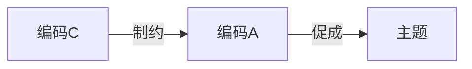

# QDA 凝练主题（Thematic Synthesis）

本 skill 不依赖 VS Code 扩展命令，直接读写 Markdown 文件，遵守 markdown-qda 的实体契约。

## 前置条件

- 用户指定编码集（若干 `tags: [code]` 的编码）
- 主题笔记放置位置（用户指定目录，或受管区）

## 主题笔记契约

```yaml
---
tags: [theme]
parent: 父主题名（可选）
---
```

正文 = 叙述性分析，可含块引用与 Mermaid 图，无需像编码文件那样是纯引用列表。

## 步骤

1. 阅读编码集：`definition`、引用片段、`parent` 层级
2. 识别主题模式：跨越多个编码的共通叙事、机制或张力
3. 每个主题建一个 md 文件（`tags: [theme]`），`definition` 用一句话概括主题
4. 主题正文：
   - 叙述主题内涵与证据（引用编码片段或概括）
   - 用 Mermaid 图绘制主题内编码的因果关系，例如：



1. 主题间可用 `parent` 建层级（总主题 → 子主题）

## 检查清单

- [ ] 主题文件 frontmatter 有 `tags: [theme]`
- [ ] Mermaid 图语法有效，因果关系基于材料证据而非臆测
- [ ] 主题与编码的关系可追溯（正文或图中有引用/命名）
- [ ] 每个主题有明确边界，与其他主题不重叠
